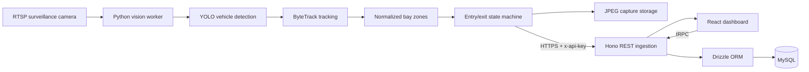

# Mirsad Technical Reference

## 1. Architecture



The browser simulation and real camera path share the same `WashEvent` presentation model. They remain distinguishable through the `source` field: `simulation`, `vision`, or `seed`.

## 2. Technology stack

| Layer | Technology |
|---|---|
| UI | React 19, TypeScript, Vite, Tailwind CSS, Radix/shadcn components |
| Localization | Custom message catalog, Arabic RTL and English LTR |
| Charts | Recharts |
| API | Hono, tRPC 11, Superjson |
| Validation | Zod |
| Persistence | Drizzle ORM, MySQL |
| Vision | Python 3.11, OpenCV, Ultralytics YOLO, ByteTrack |
| Capture delivery | Local JPEG retention plus optional S3-compatible upload |
| Packaging | Node 22 Alpine image, Python 3.11 Slim image |
| Static demo | GitHub Actions and GitHub Pages |

## 3. Camera event lifecycle

1. OpenCV reads an RTSP stream using FFmpeg.
2. YOLO filters detections to configured COCO vehicle class IDs.
3. ByteTrack assigns a tracker ID within one camera stream.
4. The worker calculates the bounding box’s normalized bottom-center point.
5. The point is matched against non-overlapping normalized bay polygons.
6. A configurable number of consecutive in-zone frames confirms entry.
7. The worker creates an operation tracking ID containing the camera ID, raw tracker ID, and unique random suffix.
8. An entry JPEG is retained and optionally uploaded.
9. The worker posts an authenticated entry event.
10. Consecutive out-of-zone frames confirm exit; the same operation tracking ID is sent.
11. The API calculates duration, completes the record, and makes its revenue available to reports.

The unique suffix is essential because tracker IDs can be reused. One model/tracker instance is maintained per camera stream.

## 4. Event contract

`POST /api/vision/events`

Required headers:

```text
Content-Type: application/json
x-api-key: VISION_API_KEY
```

Shared fields:

| Field | Type | Rule |
|---|---|---|
| `phase` | `entry` or `exit` | Required |
| `trackingId` | string | Required, 1–120 characters, identical at entry/exit |
| `cameraId` | string | Required, 1–80 characters |
| `timestamp` | ISO date/time | Required and coerced to a server date |
| `bay` | integer | Optional, 1–100 |
| `imageUrl` | URL string | Optional, maximum 2048 characters; omitted when unavailable |

Entry additionally requires:

| Field | Type | Rule |
|---|---|---|
| `size` | `small`, `medium`, `large` | Required |
| `confidence` | number | Required, 0–1 |

Responses: `201` entry, `200` exit, `400` invalid payload, `401` unauthorized, `404` unmatched exit, and `503` missing server key. The request body limit is 128 KiB.

Authentication uses a constant-time comparison after checking key length. The server fails closed when `VISION_API_KEY` is not configured.

## 5. tRPC operations

| Procedure | Purpose |
|---|---|
| `ping` | API availability check |
| `events.list` | Return recent wash events ordered by entry time |
| `events.correctSize` | Persist operator size correction and current price/cost |
| `settings.get` | Read pricing and expense settings |
| `settings.update` | Update nonnegative pricing and expense settings |

The static demo disables these requests and camera ingestion. It does not simulate a successful database write.

## 6. Database model

### `wash_events`

- Identity: auto-increment `id`, unique `tracking_id`, display `code`.
- Classification: `size`, `confidence`.
- State: `queued`, `washing`, or `completed`.
- Location: `camera_id`, optional `bay`.
- Time: `arrival_at`, `entry_at`, optional `exit_at`, calculated `duration_minutes`.
- Financial snapshot: decimal `price` and `cost`.
- Captures: optional `entry_image_url` and `exit_image_url`.
- Provenance: `source` plus creation/update timestamps.

### `app_settings`

A singleton row stores small/medium/large prices and variable costs, fixed daily expense, and labor cost. Target durations are frontend operating settings and are not currently stored in this table.

## 7. Financial calculations

For completed operations only:

```text
Revenue = Σ stored operation price
Variable cost = Σ stored operation cost
Daily net profit = revenue − variable cost − fixed daily expense − labor
```

Active and queued vehicles do not contribute recognized revenue.

```text
Average duration = Σ(exit − entry) / completed operation count
Bay utilization = occupied bay-minutes / (elapsed day minutes × 3) × 100
```

Monthly actuals include current-month completed operations and elapsed-calendar-day fixed costs. The annual view averages the recent 30-day window across active days and projects 365 days:

```text
Projected annual revenue = recent revenue / active days × 365
Projected annual variable cost = recent variable cost / active days × 365
Projected annual fixed cost = (fixed daily + labor) × 365
```

Annual values are explicitly labeled as projections.

## 8. Classification correction

An operator correction updates:

- vehicle size;
- stored price for the corrected size;
- stored variable cost for the corrected size;
- confidence to `1`, indicating confirmed operator review in the current implementation.

Reports recalculate from stored operation values. A correction does not alter entry/exit timestamps or duration.

## 9. Vision configuration

Key settings in `vision-service/cameras.example.yaml`:

| Setting | Purpose |
|---|---|
| `model` | Local or downloadable Ultralytics YOLO model |
| `confidence` | Minimum detector confidence |
| `vehicle_class_ids` | COCO classes: car 2, bus 5, truck 7 by default |
| `frame_skip` | Process every Nth frame to control load |
| `entry_frames` | Consecutive in-zone frames required for entry |
| `exit_frames` | Consecutive out-of-zone frames required for exit |
| `medium_area` | Normalized bbox area where a non-heavy vehicle becomes medium |
| `large_area` | Normalized bbox area where a non-heavy vehicle becomes large |
| `captures_dir` | Local JPEG and spool parent storage |
| `request_timeout_seconds` | API timeout |
| `reconnect_seconds` | Delay before reopening a failed stream |

`bus` and `truck` are initially classified as large. Other vehicles use the calibrated area thresholds. These are heuristics, not validated accuracy claims.

## 10. Delivery reliability and captures

- HTTP retries cover connection/read failures and selected transient status codes.
- Failed events enter a per-camera JSONL spool and retry in order.
- Entry ingestion is idempotent by unique tracking ID; exit updates the matched record.
- Capture-storage failure does not prevent delivery of the vehicle event.
- Without a durable public image URL, the UI shows an unavailable-image state.
- S3-compatible uploads require a permanent `public_base_url`; short-lived URLs are unsuitable for historical records.

A prolonged camera outage can leave an active wash without an observed exit. Site operations must review such records rather than inventing an exit time.

## 11. Demo and production modes

| Capability | GitHub Pages demo | Full-stack deployment |
|---|---|---|
| Simulation and all screens | Yes | Yes |
| Arabic/English and themes | Yes | Yes |
| Session settings | Yes | Yes |
| MySQL settings/events | No | Yes |
| Authenticated camera ingestion | No | Yes |
| RTSP/YOLO worker | No | Separate service |
| Historical seeded data | No | Optional with `SEED_DEMO_DATA=true` |

The Vite demo build uses `VITE_FRONTEND_DEMO=true`. `VITE_BASE_PATH` supports GitHub project-page subpaths. The production build emits `dist/public` plus `dist/boot.js`; the demo emits `dist/index.html` and static assets.

## 12. Security boundaries

- Secrets are read from server/worker environments, never frontend source.
- `.env`, local camera configuration, capture directories, and spools are ignored by Git.
- HTTPS is required for public camera ingestion.
- Camera ingestion is authenticated, but the dashboard currently has no staff-account system. Add organization access control before untrusted exposure.
- Use dedicated least-privilege MySQL and storage credentials.
- Apply camera capture retention and privacy policies appropriate to the deployment.

## 13. Verification and known limits

Web tests cover financial calculations, stored-price behavior, annual projection labeling, and vision-route authentication/validation. Vision unit tests cover polygons, size classification, consecutive-frame transitions, and tracker-ID reuse.

Browser verification covered all screens, both languages/themes, correction persistence, captures, CSV, reports, integration tests, and mobile overflow. No physical camera or model accuracy is claimed without on-site validation.

The production bundle currently includes a large common JavaScript chunk; route-level code splitting is a future performance improvement, not a functional blocker.
